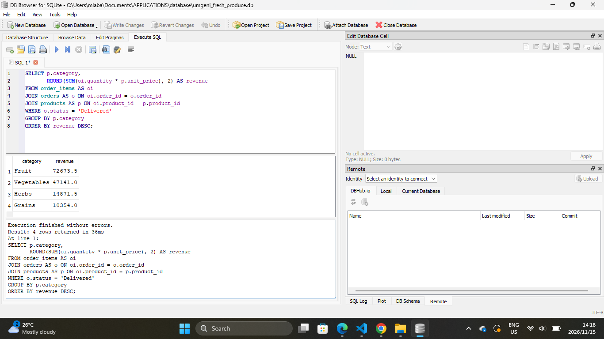
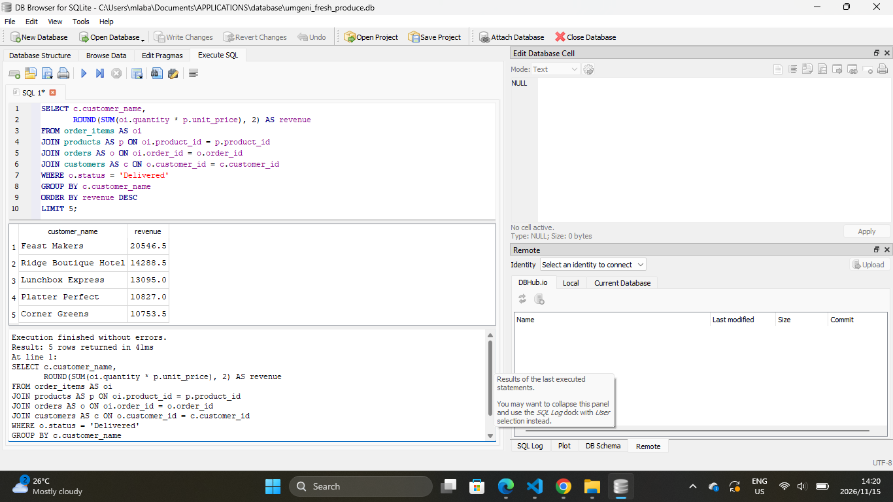
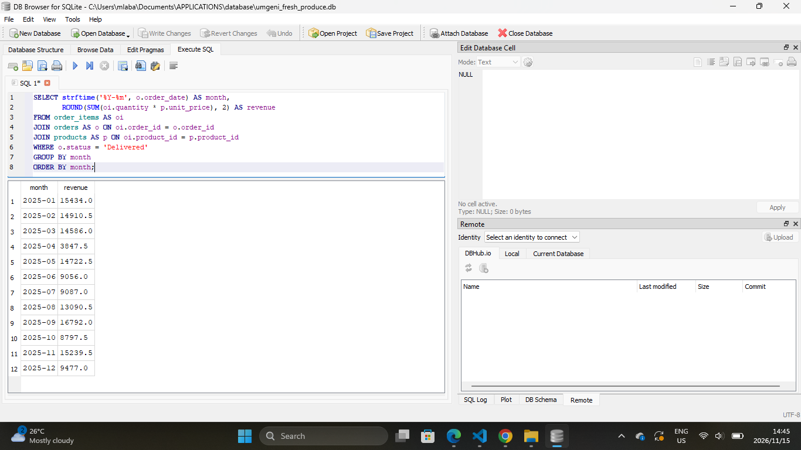
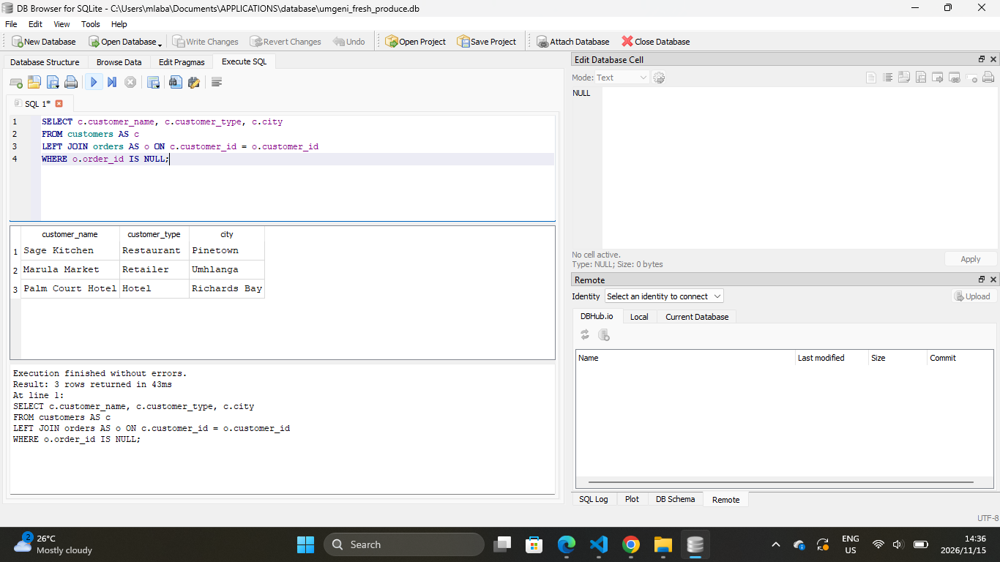

# Umgeni Fresh Produce: SQL Analysis

A beginner-to-intermediate SQL project using **SQLite**. I wrote queries to answer business questions about a fictional fresh-produce distributor that supplies restaurants, hotels, retailers and caterers in KwaZulu-Natal.

> **Note:** the dataset is synthetic (made up for practice), so the findings below show the analysis, not real-world conclusions.

## Skills demonstrated

- Filtering and sorting: `SELECT`, `WHERE`, `ORDER BY`, `LIMIT`, `BETWEEN`
- Aggregation: `COUNT`, `SUM`, `AVG`, `ROUND`, `GROUP BY`, `HAVING`
- Joining 3 to 4 tables: `INNER JOIN` and `LEFT JOIN` (finding records with no match using `IS NULL`)
- Calculated columns (quantity x unit price) and conditional labels with `CASE WHEN`
- Date grouping with `strftime` (monthly trends)

## The database

Five tables, 25 customers, 150 orders and 359 order lines covering one year (2025):

| Table | What it holds |
|---|---|
| `farms` | The farms that grow the produce |
| `products` | 15 products (fruit, vegetables, herbs, grains), each linked to a farm |
| `customers` | Businesses that buy produce, with type and city |
| `orders` | One row per order, with date and status (Delivered or Cancelled) |
| `order_items` | The products and quantities on each order |

## Business questions answered

**Basics** ([01_basics.sql](queries/01_basics.sql))
- Which fruit products are most expensive? How many orders were cancelled?
- How many customers are there of each type? Which customers are in Durban?
- How many orders were placed in March 2025?

**Joins and revenue** ([02_joins.sql](queries/02_joins.sql))
- What is the total revenue from delivered orders?
- Which product categories, farms and customers bring in the most revenue?
- Which customers have never placed an order?

**Aggregates and trends** ([03_aggregates.sql](queries/03_aggregates.sql))
- What is the monthly revenue trend?
- Which customers order frequently (10 or more delivered orders)?
- What is the average order quantity by customer type?
- Which categories earn more than R20,000?

## Example findings

- Total revenue from delivered orders: **R145,040**.
- **Fruit** is the biggest category (R72,673.50), followed by vegetables (R47,141.00).
- **Southcoast Orchards** is the top-earning farm (R49,245.50).
- **Caterers** bring in the most revenue by customer type (R61,689.50).
- **Feast Makers** is the top customer (R20,546.50) and the only one with more than 15 delivered orders.
- 5 customers qualify as "Frequent" (10 or more delivered orders).
- 3 customers have never ordered: Sage Kitchen, Marula Market and Palm Court Hotel.

## Screenshots









## How to run it

1. Install [DB Browser for SQLite](https://sqlitebrowser.org/) (free).
2. Open `database/umgeni_fresh_produce.db` with **File > Open Database**.
3. Go to the **Execute SQL** tab, paste a query from the `queries/` folder and run it with Ctrl+Enter.

To rebuild the database from scratch, run `database/umgeni_fresh_produce.sql` in the Execute SQL tab.

## Repository structure

```
├── README.md
├── database/
│   ├── umgeni_fresh_produce.db
│   └── umgeni_fresh_produce.sql
├── queries/
│   ├── 01_basics.sql
│   ├── 02_joins.sql
│   └── 03_aggregates.sql
└── screenshots/
```

## Tools

SQLite, DB Browser for SQLite, GitHub
